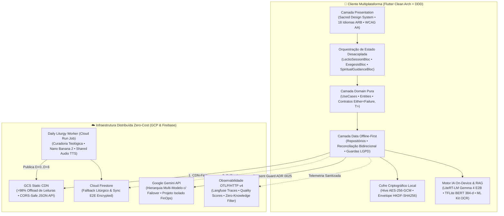

# ✠ pwE (Pray With Me) — Architecture & Staff Engineering Showcase

[](CHANGELOG.md)
[](docs/adr/README.md)
[](docs/architecture/README.md)
[](docs/ai-governance/README.md)
[](https://pwe.jhhsolutions.dev/pt-br/)
[](https://pwe.jhhsolutions.dev/pt-br/)

> **Repositório Público de Arquitetura, Decisões de Engenharia (ADRs), Governança Multiagente e Recortes de Código Real (*Clean Code Slices*) do ecossistema [pwE — Pray With Me](https://pwe.jhhsolutions.dev/pt-br/).**
>
> *Nota de Propriedade Intelectual:* O repositório principal de produção do **pwE** é mantido **100% privado** para proteger a propriedade intelectual teológica e pastoral (engenharia de prompts mistagógicos, matrizes exegéticas das *7 Gotas de Sabedoria*, heurísticas de *Fading Scaffolding*, workers de ingestão litúrgica e regras de cofre criptográfico). Este repositório é sincronizado e sanitizado automaticamente via [`tool/sync_showcase.dart`](docs/adr/0051-repositorio-publico-architecture-showcase-e-sanitizacao-automatizada.md).

---

## 🌐 Links Oficiais do Produto

- **Vitrine Institucional (PT-BR):** [https://pwe.jhhsolutions.dev/pt-br/](https://pwe.jhhsolutions.dev/pt-br/)
- **Vitrine Institucional (EN-US):** [https://pwe.jhhsolutions.dev/](https://pwe.jhhsolutions.dev/)
- **Web App (PWA / Flutter Web):** [https://pwe.jhhsolutions.dev/app](https://pwe.jhhsolutions.dev/app)

---

## 🏛️ Visão Executiva de Arquitetura

O **pwE (Pray With Me)** é uma plataforma multiplataforma (**Android, iOS e Web**) para a prática contemplativa da **Lectio Divina** (Leitura Orante da Bíblia em 4 passos: *Lectio, Meditatio, Oratio, Contemplatio*), construída sob rigorosos padrões de **Clean Architecture**, **Domain-Driven Design (DDD)**, **Privacidade Zero-Knowledge (`AES-256-GCM`)**, **Inferência Híbrida Cloud/Edge (`Gemini 3.x` + `Gemma 4 E2B On-Device`)** e **Engenharia FinOps Free-Tier Perpétuo**.



---

## 📂 Estrutura deste Repositório de Showcase

```text
pwe-architecture-showcase/
├── README.md                          # Vitrine executiva de arquitetura e índice navegável
├── CHANGELOG.md                       # Espelho público sanitizado das 115+ releases (maturidade SemVer)
├── docs/
│   ├── adr/                           # Todos os 51 ADRs (0001 a 0051) documentando decisões e trade-offs
│   ├── architecture/                  # Diagramas C4, Fluxos de Sequência, Máquinas de Estados e Criptografia
│   └── ai-governance/                 # Arquitetura do Comitê de 17 Agentes Especialistas (Google Antigravity)
└── showcase/                          # "Clean Code Slices": código real Flutter/Dart + testes unitários/widget
    ├── state_management/              # LectioSessionBloc + Equatable State + bloc_test
    ├── edge_ai_bridge/                # MethodChannel LiteRT-LM (GPU->CPU Failover) + Token-Bucket Rate Limiter
    ├── platform_security/             # ScreenSecurityService (FLAG_SECURE dinâmico) + testes unitários
    └── sacred_design_system/          # HoldToSaveButton (CustomPainter) + AdaptiveTwoPane + widget tests
```

---

## 🧩 1. Clean Code Slices ([`showcase/`](showcase/README.md))

Recortes reais extraídos diretamente da árvore de produção (`lib/` e `test/`), 100% livres de segredos de negócio, demonstrando o padrão de codificação, tipagem estrita (`strict-casts`, `strict-inference`, `strict-raw-types`) e cobertura de testes:

| Domínio de Engenharia | Arquivos de Produção (`lib/`) | Suíte de Testes (`test/`) | Destaques Arquiteturais |
| :--- | :--- | :--- | :--- |
| **State Management & DDD** | [`lectio_session_bloc.dart`](showcase/state_management/lectio_session_bloc.dart)<br/>[`lectio_session_event.dart`](showcase/state_management/lectio_session_event.dart)<br/>[`lectio_session_state.dart`](showcase/state_management/lectio_session_state.dart) | [`lectio_session_bloc_test.dart`](showcase/state_management/lectio_session_bloc_test.dart) | Decomposição do antigo *God BLoC* ([ADR 0015](docs/adr/0015-decomposicao-god-bloc-e-higiene-arquitetura-dados.md)), imutabilidade com `Equatable`, *Fading Scaffolding* e tratamento funcional `Either<Failure, T>`. |
| **Edge AI Bridge & Rate Limiting** | [`llm_local_datasource.dart`](showcase/edge_ai_bridge/llm_local_datasource.dart)<br/>[`llm_rate_limiter.dart`](showcase/edge_ai_bridge/llm_rate_limiter.dart) | [`llm_local_datasource_test.dart`](showcase/edge_ai_bridge/llm_local_datasource_test.dart)<br/>[`llm_rate_limiter_test.dart`](showcase/edge_ai_bridge/llm_rate_limiter_test.dart) | Ponte nativa `MethodChannel('pwe/gemma_local')` para o motor **Gemma 4 E2B (LiteRT-LM)** ([ADR 0005](docs/adr/0005-edge-llm-strategy.md)), failover automático `GPU -> CPU` em caso de erro `OpenCL`/`Vulkan`/timeout, suporte a `CancellationToken` e anti-burst por operação. |
| **Platform Security & Privacy** | [`screen_security_service.dart`](showcase/platform_security/screen_security_service.dart) | [`screen_security_service_test.dart`](showcase/platform_security/screen_security_service_test.dart) | Controle dinâmico em runtime de `FLAG_SECURE` no Android e detecção de captura no iOS ([ADR 0044](docs/adr/0044-privacidade-de-tela-configuravel-e-partilha-sacra.md)), compatível com compilação Web/Wasm. |
| **Sacred Design System & A11y** | [`hold_to_save_button.dart`](showcase/sacred_design_system/hold_to_save_button.dart)<br/>[`adaptive_two_pane.dart`](showcase/sacred_design_system/adaptive_two_pane.dart) | [`hold_to_save_button_test.dart`](showcase/sacred_design_system/hold_to_save_button_test.dart)<br/>[`adaptive_two_pane_test.dart`](showcase/sacred_design_system/adaptive_two_pane_test.dart) | Microinteração contemplativa com `CustomPainter` + feedback háptico, rotulagem `Semantics(identifier: ...)` para o *Firebase App Testing Agent* ([ADR 0016](docs/adr/0016-firebase-app-testing-agent-e-acessibilidade-semantica.md)) e layout responsivo multi-viewport sem `IntrinsicHeight` inseguro ([ADR 0045](docs/adr/0045-automacao-dod-i18n-e-viewport-matrix.md)). |

---

## 📐 2. Architecture Decision Records ([`docs/adr/`](docs/adr/README.md))

O projeto mantém **51 ADRs** documentando toda a evolução arquitetural, desde a escolha de gerência de estado até a engenharia FinOps e validação em runtime via MCP. Alguns destaques:

- **[ADR 0003](docs/adr/0003-rag-on-device.md) & [ADR 0006](docs/adr/0006-local-embeddings-strategy.md):** Memória Contextual RAG 100% On-Device com modelo BERT TFLite quantizado (vetores de 384 dimensões e busca por similaridade de cosseno local).
- **[ADR 0005](docs/adr/0005-edge-llm-strategy.md):** Inferência LLM On-Device com Gemma 4 E2B (LiteRT-LM), janela deslizante de contexto e fallback automático GPU → CPU.
- **[ADR 0010](docs/adr/0010-observabilidade-dupla-camada-e-privacidade-zero-knowledge.md) & [ADR 0026](docs/adr/0026-senha-opcional-do-cofre-de-chaves.md) & [ADR 0029](docs/adr/0029-cifra-em-repouso-da-caixa-hive.md):** Arquitetura de Privacidade Zero-Knowledge, criptografia em repouso `AES-256-GCM` da caixa Hive e envelope criptográfico `HKDF-SHA256` (`wrapped:v2:salt:iv:ciphertext`).
- **[ADR 0015](docs/adr/0015-decomposicao-god-bloc-e-higiene-arquitetura-dados.md) & [ADR 0027](docs/adr/0027-remocao-fisica-do-lectio-bloc.md):** Decomposição estranguladora (*Strangler Fig*) de um monolito de estado em 5 BLoCs coesos e independentes.
- **[ADR 0021](docs/adr/0021-marionette-mcp-e-interacao-em-tempo-de-execucao-para-agentes-ia.md) & [ADR 0050](docs/adr/0050-validacao-runtime-perf-validator-e-documentacao-tecnica-mestre.md):** Inspeção e validação autônoma em tempo de execução por agentes de IA via **Marionette MCP** e **Dart VM Service MCP** em hardware físico.
- **[ADR 0039](docs/adr/0039-isolamento-estrito-de-chaves-e-blindagem-finops-multi-projeto.md) & [ADR 0047](docs/adr/0047-offload-liturgia-gcs-cdn-e-shared-tts.md):** Isolamento FinOps multi-projeto e Offload de >98% das leituras diárias do Firestore via **Google Cloud Storage Static CDN** CORS-safe.
- **[ADR 0046](docs/adr/0046-governanca-remota-de-versao-e-langfuse-scores.md):** Governança remota de versão, Firebase GitOps e ciclo fechado de avaliação de qualidade (*Quality Scores*) via OpenTelemetry (`OTLP/HTTP v4`) no Langfuse.

👉 **[Acesse o Índice Completo dos 51 ADRs em `docs/adr/README.md`](docs/adr/README.md)**

---

## 🗺️ 3. Diagramas C4, Sequência e Máquinas de Estado ([`docs/architecture/`](docs/architecture/README.md))

Toda a topologia do sistema está modelada em diagramas Mermaid auditáveis:

1. **[Visão Geral da Clean Architecture e DI Modular](docs/architecture/architecture_overview.md)**
2. **[Modelo C4 Completo (Contexto, Containers e Componentes)](docs/architecture/c4_model.md)**
3. **[Diagramas de Sequência (Ingestão Litúrgica, IA Híbrida, OCR e RevenueCat)](docs/architecture/sequence_diagrams.md)**
4. **[Máquinas de Estados dos BLoCs Core](docs/architecture/state_machines.md)**
5. **[Fluxo Detalhado da Sessão da Lectio Divina](docs/architecture/lectio_divina_sequence.md)**
6. **[Observabilidade OTLP v4 & Filtro Ético Zero-Knowledge](docs/architecture/observability_flow.md)**
7. **[Backend Distribuído (Daily Liturgy Worker & GCS Static CDN)](docs/architecture/distributed_liturgy_bff.md)**
8. **[Segurança & Ciclo de Vida de Criptografia AES-256-GCM](docs/architecture/security_and_encryption.md)**

---

## 🤖 4. Governança Multiagente no Google Antigravity ([`docs/ai-governance/`](docs/ai-governance/README.md))

O desenvolvimento e a auditoria contínua do **pwE** são conduzidos por uma arquitetura orquestrada de **17 Agentes Especialistas** divididos em **4 Pilares Estratégicos** (Governança/FinOps/Doutrina, Engenharia/Dados/IA, Interface/Plataforma/Arte Sacra e Qualidade/Diagnóstico/DevOps), operando com *Progressive Disclosure Skills* e validação em hardware real.

👉 **[Leia a Documentação Completa da Governança Multiagente e Versionamento de Prompts em `docs/ai-governance/README.md`](docs/ai-governance/README.md)**

---

## 🛡️ Matriz de Fronteira: Público vs. Privado

| Camada / Artefato | Neste Showcase Público? | Política de Segurança e Propriedade Intelectual |
| :--- | :---: | :--- |
| **51 ADRs (`0001` a `0051`) & Diagramas C4/Mermaid** | ✅ **SIM** | Sanitizados automaticamente por `tool/sync_showcase.dart`. |
| **Clean Code Slices (`showcase/`) + Testes Unitários/Widget** | ✅ **SIM** | Código real demonstrando Clean Architecture, BLoC, MethodChannels nativos e Design System. |
| **Catálogo da Governança Multiagente (17 Agentes)** | ✅ **SIM** | Documenta a orquestração em 3 camadas e auditoria runtime via Marionette/Dart MCP. |
| **`CHANGELOG.md` (115+ Releases SemVer)** | ✅ **SIM** | Prova viva de cadência de entrega contínua e disciplina de engenharia. |
| **System Prompts Pastorais, *7 Gotas* & Prompts Socráticos** | ❌ **NUNCA** | Propriedade intelectual core. Documentamos apenas a arquitetura de hash/telemetria com `[REDACTED_PASTORAL_PROMPT]`. |
| **Workers de Ingestão CNBB / LitCal v5 & Regras de Assinatura** | ❌ **NUNCA** | Proteção de pipeline e regras server-authoritative. |
| **Chaves, IDs de Projeto GCP/Firebase, Buckets e `.env`** | ❌ **NUNCA** | Redigidos pelo *Redaction Engine* e verificados pelo *Leak Scanner* antes de cada push. |

---

## 💬 Feedback, Bug Reports e Discussões Arquiteturais

Encontrou uma oportunidade de melhoria no aplicativo ou deseja discutir alguma decisão arquitetural documentada nos ADRs?
- Abra uma **[Issue neste repositório](https://github.com/evslopes/pwe-architecture-showcase/issues)** para relatar bugs ou sugerir melhorias na experiência do **pwE**.
- Conheça o aplicativo publicado em **[pwe.jhhsolutions.dev/pt-br/](https://pwe.jhhsolutions.dev/pt-br/)**.
