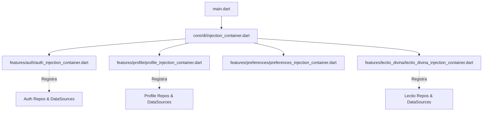

# ADR 0004: Injeção de Dependências Modular e Reforço do Clean Architecture

## Status
Aceito e Implementado

## Contexto
Com a rápida escalada de features do projeto **pwE (Pray With Me)** — incluindo `lectio_divina`, `auth`, `profile`, `preferences` e integrações robustas de Machine Learning (Google ML Kit, Gemini) — observou-se uma degradação da fronteira do núcleo (Core) da aplicação.
Todas as dependências do projeto estavam sendo injetadas e registradas no arquivo global `core/di/injection_container.dart`. Isso provocava o chamado "acoplamento do Core", onde a camada base da aplicação se via obrigada a conhecer as bibliotecas externas, Repositórios e implementações de DataSources específicos de todas as features individuais, quebrando a segregação do *Domain-Driven Design* (DDD) e do *Clean Architecture*.

## Decisão
Para garantir que o `core` se mantenha agnóstico ("cego" ao que existe fora dele) e coeso, oficializamos a refatoração arquitetural baseada no padrão de **Contêineres de Injeção Isolados por Feature**. A governança também passa a ser reforçada proativamente por meio da instrumentação de Agentes Autônomos de IA dentro do ciclo da engenharia (Copilot, fluxos de CI/QA).

As **Regras de Ouro** estabelecidas na camada arquitetural são:

1. **Contêiner Global Mínimo:** O `core/di/injection_container.dart` passa a injetar *exclusivamente* serviços genéricos da infraestrutura da plataforma (Firebase, Analytics, client HTTP base, Storage local como Hive) ou abstrações não atreladas a domínios de negócio.
2. **Contêineres Locais de Feature:** Cada feature passa a orquestrar suas injeções via `GetIt` no seu próprio contêiner modular (ex: `features/auth/auth_injection_container.dart`, `features/lectio_divina/lectio_divina_injection_container.dart`).
3. **Orquestração Delegada:** O contêiner de `core` central apenas aciona a inicialização das features (`await initFeatureInjection()`) de maneira assíncrona, não acessando ou importando nenhuma implementação subjacente de dados.
4. **Imports Absolutos Obrigatórios:** Qualquer tráfego de interface entre módulos ou na mesma feature deve ser feito via imports absolutos (`package:pwe/[layer]/...`). Imports relativos de subida/descida violam a diretriz estrita.
5. **Isolamento de Mock e Testes:** Instâncias falsas e zombações de testes (`Mocktail`) jamais cruzarão fronteiras para os DataSources internos se o teste for de domínio. Devem se guarnecer nos contratos (interfaces) de Domain.

## Estrutura Topológica do DI Modular

## Consequências

### Positivas
- **Independência Real:** Alterações na camada de persistência de `Profile` ou migração do modelo do LLM em `Lectio` não demandarão recargas ou edições em injeções estruturais base. O core não terá instabilidade sistêmica.
- **Integração Sustentável:** O app suportará novas features em paralelo distribuídas para a equipe com menor atrito de código (merge conflicts) no arquivo do contêiner central.
- **Maturidade das IAs e Pipelines:** Com a adoção de instruções explícitas (como o arquivo `.github/copilot-instructions.md` e metadados no `workflows/`), o enforcement dessa política na PR ficará muito mais rigoroso.

### Negativas (Trade-offs)
- Aumenta-se a verbosidade de *boilerplates* no start de novos domínios. A cada nova feature, desenvolvedores são obrigados a estender essa mesma arquitetura modular.
- Pode resultar em pequenos esquecimentos em inicializações da Main onde o desenvolvedor escreve a feature inteira isolada mas não notifica o chamador principal da base. No entanto, estes casos apresentarão falha precoce em ciclo inicial de testes.
