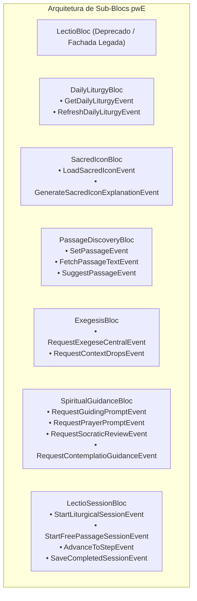

# ADR 0015: Decomposição do God Bloc (LectioBloc), Modularização de Parsers e Higiene da Arquitetura de Dados

**Status:** Aprovado  
**Data:** 23 de Setembro de 2026  
**Contexto:** Sprint 8 — Refatoração Estrutural de Dados, Desacoplamento de Blocs e Conformidade Estrita com Clean Architecture / DDD  

---

## 1. Contexto e Problema

Com o amadurecimento das funcionalidades do **pwE (Pray With Me)** — incluindo suporte a múltiplos níveis de maturidade espiritual, exegese patrística progressiva, gotas de contexto, ícones sacros da Tradição e gestão de assinaturas para Benfeitores — foram identificados débitos técnicos estruturais críticos na modelagem e no tráfego de dados:

1. **God Bloc (`LectioBloc` com 1.497 linhas):**
   O `LectioBloc` centralizava 17 dependências injetadas e 26 eventos heterogêneos. Ele coordenava desde a ingestão da liturgia diária, busca de passagens bíblicas, geração de arte sacra, extração de exegese, orientação socrática, até a persistência local e gestão de streaks do perfil. Qualquer alteração em um domínio colateral exigia recompilação e testes no monólito.
2. **God Model (`DailyLiturgyModel` com 1.142 linhas):**
   O modelo de dados agregava cinco responsabilidades distintas em um único arquivo: modelo de dados (DTO), sanitização por regex (`LiturgySanitizer`), tradução de termos para 7 idiomas (`LiturgyTranslator`), parser da API CNBB (`CnbbLiturgyParser`) e web scraping da Canção Nova (`HtmlLiturgyParser`).
3. **Crescimento Descontrolado do Cache Local (Hive):**
   O `DailyLiturgyLocalDataSource` persistia as liturgias sem nenhuma política de descarte (*TTL eviction*), ocupando espaço desnecessário no dispositivo do fiel ao longo dos meses.
4. **Violação de Camadas em `ReadingPreferencesBloc`:**
   O BLoC de preferências acessava diretamente a interface `ReadingPreferencesRepository` a partir da camada de apresentação, sem intermediar por casos de uso (`UseCases`), quebrando o princípio de inversão de dependência da Clean Architecture.
5. **Ausência de Models na Camada de Dados para Assinaturas (`features/subscription`):**
   A camada de dados da funcionalidade de benfeitores manipulava diretamente as entidades de domínio (`SubscriptionStatus` e `SubscriptionPlan`), violando o isolamento entre camadas de *Data* e *Domain*.
6. **Use Cases Mortos/Deprecados:**
   Casos de uso antigos (`GenerateMeditationUseCase` e `GeneratePrayerUseCase`) permaneciam registrados no container de injeção de dependência e nos testes, apesar de o paradigma orante ter migrado para a provocação socrática e orações estruturadas na Tradição.

---

## 2. Decisão Arquitetural

Adotou-se uma intervenção profunda e cirúrgica em quatro fases estruturadas:

### 2.1. Extração e Especialização de Parsers (Fase 1A)
- O `DailyLiturgyModel` foi reduzido de **1.142 linhas para 207 linhas**, concentrando-se exclusivamente em serialização/deserialização e mapeamento para entidade.
- Toda a lógica algorítmica foi extraída para quatro classes utilitárias puras e isoladamente testáveis em `lib/features/lectio_divina/data/utils/`:
  - `LiturgySanitizer`: Limpeza de rubricas, aclamações e normalização de quebras de linha bíblicas.
  - `LiturgyTranslator`: Mapeamento de termos e tempos litúrgicos em múltiplos idiomas canônicos.
  - `CnbbLiturgyParser`: Extração determinística de leituras a partir do payload JSON da CNBB.
  - `HtmlLiturgyParser`: Parsing e higienização do HTML de fallback.

### 2.2. Introdução de UseCases para Preferências (Fase 1B)
- Criados `GetReadingPreferencesUseCase` e `SaveReadingPreferencesUseCase` retornando `Either<Failure, Type>`.
- `ReadingPreferencesBloc` agora consome estritamente os casos de uso, blindando a camada de apresentação de detalhes de infraestrutura.

### 2.3. Decomposição do `LectioBloc` em 6 Sub-Blocs Coesos (Fase 2)
O monolítico `LectioBloc` foi decomposto em 6 BLoCs atômicos e especializados, cada um com sua tríade (`Bloc`, `Event`, `State`):

- **Migração Integral da Apresentação:** As cinco principais telas do aplicativo (`DailyDashboardPage`, `LectioPage`, `ImmersiveReadingPage`, `PreparationPage` e `SacredIconContemplationDialog`) foram migradas para consumir os sub-blocs correspondentes via `MultiBlocProvider`.
- **Unificação Canônica de `ImmersiveStep`:** O enum `ImmersiveStep` foi centralizado e canonicamente exportado, eliminando duplicidades de tipos entre estados de sessão e navegação.

### 2.4. Higiene de Dados, Modelos e Cache TTL (Fase 3)
1. **Cache TTL no Hive:**
   Implementada a política de descarte automático em `DailyLiturgyLocalDataSource`: entradas no Hive com data anterior a **7 dias** são limpas na inicialização, preservando espaço de armazenamento do dispositivo.
2. **Criação de DTOs para Assinaturas:**
   Criados `SubscriptionPlanModel` e `SubscriptionStatusModel` na camada de dados (`features/subscription/data/models/`), implementando `operator ==` e `hashCode` com suporte a igualdade polimórfica para com a entidade `SubscriptionStatus`.
3. **Remoção de Código Morto:**
   Exclusão formal de `GenerateMeditationUseCase` e `GeneratePrayerUseCase` em produção e no container GetIt (`injection_container.dart`).

---

## 3. Consequências

- **Manutenibilidade e Coesão:** Cada BLoC possui no máximo 6 dependências e trata apenas eventos de sua fronteira de contexto delimitado (Bounded Context).
- **Desempenho de Rebuild:** A UI reconstrói apenas os nós associados aos sub-blocs acionados (ex: gerar explicação de ícone afeta apenas o card de ícone sem acionar a árvore de exegese).
- **Higiene de Armazenamento:** Dispositivos móveis antigos não acumulam lixo de cache perpétuo no Hive.
- **Conformidade Estrita:** 
  - `flutter analyze lib/ test/`: **Zero issues (No issues found!)**.
  - `flutter test`: **931 testes passando (100% de sucesso)**.
