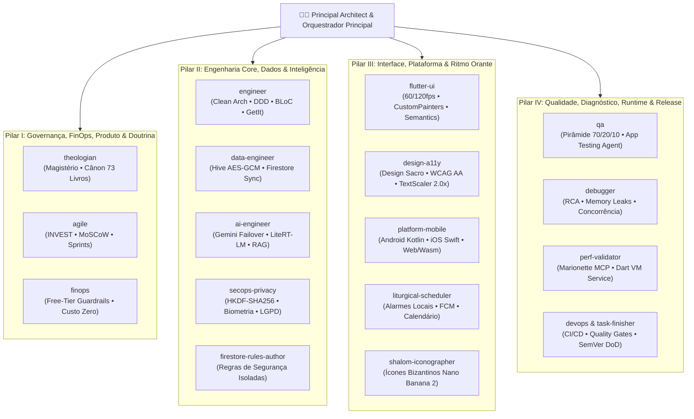
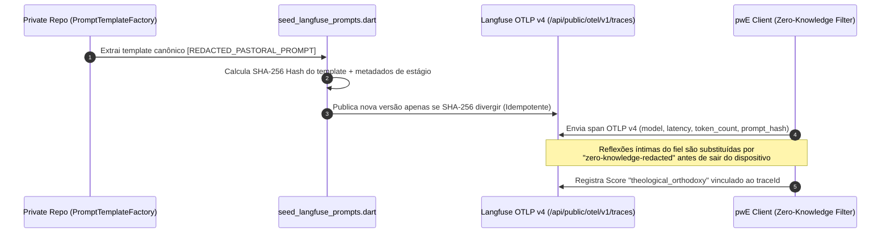

# 🤖 Governança Multiagente (17 Especialistas) & Observabilidade de IA

Este documento descreve como o ecossistema **pwE (Pray With Me)** estrutura sua engenharia assistida por IA no **Google Antigravity** ([ADR 0034](../adr/0034-arquitetura-de-subagentes-assincronos-antigravity.md) e [ADR 0050](../adr/0050-validacao-runtime-perf-validator-e-documentacao-tecnica-mestre.md)) e como governa o versionamento e a qualidade de prompts no **Langfuse OTLP v4** ([ADR 0046](../adr/0046-governanca-remota-de-versao-e-langfuse-scores.md)) sem expor segredos de negócio ou reflexões privadas dos fiéis.

---

## 1. Arquitetura de Orquestração em 3 Camadas

O repositório principal opera sob uma arquitetura multiagente dividida em três níveis complementares:

1. **Subagentes Assíncronos Nativos (`.agents/agents/<name>.md`):**
   - Agentes autônomos com escopo de ferramentas restrito (*least privilege*: leitura vs. escrita/execução), invocados concorrentemente via `invoke_subagent` em worktrees isoladas ou compartilhadas.
2. **Habilidades Progressivas (`.agents/skills/<name>/SKILL.md`):**
   - Manuais operacionais carregados sob demanda (*Progressive Disclosure*) apenas quando a tarefa aciona o domínio específico, preservando a janela de contexto.
3. **Agentes de Revisão e Workspace (`.github/agents/<name>.agent.md`):**
   - Personas espelhadas para inspeção automatizada em Pull Requests e fluxos CI/CD.



---

## 2. Catálogo dos 17 Agentes Especialistas

| Pilar | Agente | Responsabilidade Técnica e Critérios de Aceite |
| :--- | :--- | :--- |
| **I. Governança & Doutrina** | `theologian` | Curadoria doutrinária católica, integridade do Cânon de 73 livros (incluindo Deuterocanônicos), revisão das *7 Gotas de Sabedoria* e isolamento absoluto entre linguagem técnica e experiência de oração. |
| **I. Governança & Doutrina** | `agile` | Planejamento Lean, decomposição INVEST, priorização MoSCoW, critérios DoR/DoD e rastreabilidade de épicos. |
| **I. Governança & Doutrina** | `finops` | Auditoria contínua de consumo GCP/Firebase/GitHub Actions, proteção de cota gratuita (*Free Tier perpétuo*) e emissão de *FinOps Clearance* pré-release. |
| **II. Engenharia & IA** | `engineer` | Guardião da Clean Architecture, isolamento da camada `domain/`, injeção de dependência modular por feature (`GetIt`), tratamento funcional (`Either<Failure, T>`) e zero warnings no Dart Analyzer estrito. |
| **II. Engenharia & IA** | `data-engineer` | Reconciliação bidirecional Offline-First (`Hive` + `Cloud Firestore`), offload via GCS Static CDN (>98% de economia de leituras) e migração de esquemas. |
| **II. Engenharia & IA** | `ai-engineer` | Roteamento híbrido Cloud/Edge (`Gemini` + `Gemma 4 E2B LiteRT-LM`), memória contextual RAG com embeddings locais BERT (384 dimensões), `CancellationToken` e fallback patrístico offline. |
| **II. Engenharia & IA** | `secops-privacy` | Criptografia em repouso (`AES-256-GCM`), envelope de chave `HKDF-SHA256` (`wrapped:v2`), proteção contra *Prompt Injection*, `FLAG_SECURE` dinâmico e expurgo atômico LGPD/GDPR. |
| **II. Engenharia & IA** | `firestore-rules-author` | Especialista dedicado exclusivamente à autoria e auditoria de regras declarativas `firestore.rules` contra escalação de privilégios e enumeração. |
| **III. Interface & Plataforma** | `flutter-ui` | Implementação de widgets contemplativos a 60/120fps, `CustomPainter` sacros (`CandleFlameWidget`, `HoldToSaveButton`) e layouts responsivos (`AdaptiveTwoPane`). |
| **III. Interface & Plataforma** | `design-a11y` | Conformidade WCAG AA, suporte a `TextScaler` até `2.0x` sem `RenderFlex overflow`, identificadores semânticos `Semantics(identifier: ...)` e paridade em **18 catálogos ARB**. |
| **III. Interface & Plataforma** | `platform-mobile` | Pontes nativas Kotlin (`GemmaInferencePlugin.kt`, `MainActivity.kt`) e Swift (`GemmaInferencePlugin.swift`, `AppDelegate.swift`), *Privacy Manifests* Apple e paridade Web/Wasm. |
| **III. Interface & Plataforma** | `liturgical-scheduler` | Agendamento exato de lembretes de oração, tópicos litúrgicos FCM (`liturgy_{lang}`) e adaptação de cores por tempo litúrgico (Verde, Roxo, Branco, Vermelho, Rosa). |
| **III. Interface & Plataforma** | `shalom-iconographer` | Direção de arte sacra em têmpera bizantina (inspirada na Oficina Veni Creator) via modelos de imagem e harmonização automática de molduras (`SacredIconPixelHarmonizer`). |
| **IV. Qualidade & Operações** | `qa` | Manutenção da pirâmide de testes (70% Unit / 20% BLoC / 10% Widget & E2E), matriz de 6 viewports e suítes declarativas para o *Firebase App Testing Agent*. |
| **IV. Qualidade & Operações** | `debugger` | Diagnóstico de causa raiz (RCA), prevenção de vazamento de streams/controllers, concorrência de BLoC e resiliência de rede. |
| **IV. Qualidade & Operações** | `perf-validator` | Auditoria não-intrusiva em **tempo de execução (runtime)** em dispositivo físico/emulador via **Marionette MCP** e **Dart VM Service MCP**: inspeciona árvore de widgets viva, logs de BLoC, crescimento de heap e overflows. |
| **IV. Qualidade & Operações** | `devops` & `task-finisher` | Orquestração do Rito de Finalização de Tarefas (`tool/pwe_release.dart`), sincronização de ARBs (`tool/i18n_sync.dart`), deploy local zero-CI (`tool/pwe_local_deploy.dart`) e atualização deste Showcase (`tool/sync_showcase.dart`). |

---

## 3. Governança de Prompts Pastorais & Telemetria Zero-Knowledge (ADR 0010 & ADR 0046)

Os prompts pastorais e exegéticos do **pwE** constituem propriedade intelectual reservada e permanecem exclusivamente no repositório privado. Entretanto, a **arquitetura de engenharia que versiona, audita e avalia a qualidade teológica desses prompts** segue um ciclo fechado determinístico:



### Exemplo de Payload Sanitizado (Zero-Knowledge Observation)

```json
{
  "resourceSpans": [
    {
      "scopeSpans": [
        {
          "spans": [
            {
              "name": "lectio.meditatio.guidance",
              "attributes": [
                { "key": "langfuse.prompt.name", "value": { "stringValue": "meditatio_spiritual_director_v4" } },
                { "key": "langfuse.prompt.sha256", "value": { "stringValue": "e3b0c44298fc1c149afbf4c8996fb92427ae41e4649b934ca495991b7852b855" } },
                { "key": "langfuse.observation.prompt_template", "value": { "stringValue": "[REDACTED_PASTORAL_PROMPT]" } },
                { "key": "langfuse.observation.input", "value": { "stringValue": "zero-knowledge-redacted (len=342)" } },
                { "key": "gen_ai.request.model", "value": { "stringValue": "gemini-3.5-flash-lite" } }
              ]
            }
          ]
        }
      ]
    }
  ]
}
```
