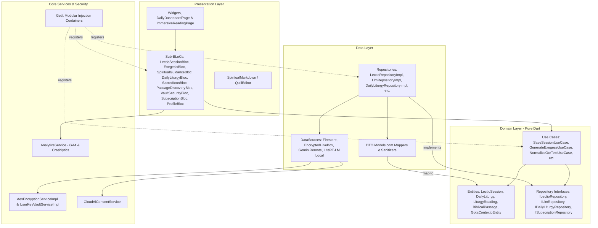

# Visão Geral da Arquitetura — pwE (Pray With Me)

O projeto pwE segue rigorosamente os princípios de **Clean Architecture** e **Domain-Driven Design (DDD)** para garantir testabilidade, isolamento das regras de negócio católicas e independência de frameworks externos.

## 1. Estrutura de Camadas e Injeção de Dependências



## 2. Estrutura de Pastas (Padrão do Projeto)

```text
lib/
├── core/                        # Recursos compartilhados e infraestrutura
│   ├── config/                  # Configurações de ambiente (EnvConfig)
│   ├── di/                      # Container de Injeção de Dependência Modular (GetIt)
│   ├── error/                   # Falhas funcionais e exceções (Failures)
│   ├── network/                 # REST Clients e interceptors de rede
│   ├── privacy/                 # Serviço de consentimento de IA em nuvem
│   ├── routes/                  # Navegação declarativa com GoRouter e guard reativo
│   ├── security/                # Criptografia AES-256-GCM, PBKDF2 e Key Vault
│   ├── services/                # Serviços centrais (TTS, Analytics, Langfuse)
│   └── theme/                   # Tokens sacros, SacredThemeColors e paletas litúrgicas
├── features/                    # Domínios de negócio isolados (Clean Arch)
│   ├── auth/                    # Autenticação Google, Apple, Anônima e exclusão LGPD
│   ├── lectio_divina/           # Domínio central: Liturgia, IA, OCR, 4 Degraus, Caderno Espiritual
│   ├── preferences/             # Configurações Litúrgicas, Idiomas e Tipografia
│   ├── profile/                 # Maturidade Espiritual, Intenções e Perfil
│   ├── security_vault/          # Cofre de segurança com senha opcional (ADR 0026)
│   ├── splash/                  # Splash contemplativa e seleção de IA (/ai_selection)
│   └── subscription/            # Monetização Ética, RevenueCat e Gestão de Benfeitores
└── main.dart                    # Bootstrap, inicialização de plugins e execução
```

## 3. Pilares Arquiteturais

1. **Pureza do Domínio**: A pasta `domain/` é escrita em Dart puro e não possui dependências do Flutter, Firebase ou pacotes de infraestrutura externa.
2. **Tratamento Funcional de Erros**: Uso estrito do pacote `dartz` (`Either<Failure, T>`) em todos os UseCases e Repositórios, eliminando o lançamento descontrolado de exceções (`try-catch` restrito aos DataSources).
3. **Containers Modulares de DI**: Cada feature possui seu próprio container de injeção (`*_injection_container.dart`), invocado a partir do container mestre `injection_container.dart`.
4. **Segurança em Camadas**: Criptografia AES-256-GCM nas anotações do Caderno Espiritual, cofre com senha opcional (`wrapped:v3` — ADR 0026), cifra em repouso da caixa Hive (`EncryptedHiveBoxOpener` — ADR 0029) e consentimento explícito para IA em nuvem (`ICloudAiConsentService` — ADR 0025).
