# Modelo C4 Arquitetural — pwE (Pray With Me)

**Data de Atualização:** 17 de Outubro de 2026  
**Padrão:** C4 Model (Contexto, Container e Componente) em sintaxe nativa Mermaid  
**Escopo:** Aplicativo Mobile & Web Flutter (`/app`), Backend Distribuído de Liturgia, GCS Static CDN, Motores de IA e Armazenamento Seguro (v0.9.113+141 / ADRs 0001–0050)  

---

## 1. Nível 1: Diagrama de Contexto do Sistema (System Context)

O Diagrama de Contexto descreve como o fiel interage com o aplicativo e como o pwE se conecta aos serviços externos e sistemas do ecossistema católico e de nuvem.

```mermaid
graph TB
    User((Fiel Católico Orante))
    pwE["pwE: Aplicativo Mobile & Web Flutter (/app)<br/><i>Lectio Divina, Liturgia Oficial e Caderno Espiritual</i>"]

    subgraph External_Catholic ["Fontes Litúrgicas Oficiais"]
        CNBBAPI["API Oficial da CNBB & LitCal v5<br/><i>Lecionário Dominical e Ferial da Igreja</i>"]
        CancaoNova["Portal Canção Nova<br/><i>Fallback Litúrgico de Contingência</i>"]
    end

    subgraph External_Cloud ["Infraestrutura e Serviços em Nuvem"]
        BFFWorker["Worker Noturno de Liturgia<br/><i>Cloud Run Job + Cloud Scheduler (GCP, 03:00 UTC)</i>"]
        GCS_CDN[("GCS Static CDN (sacred-assets)<br/><i>JSONs Litúrgicos, Ícones e Áudio TTS (ADR 0047)</i>")]
        Firestore[("Cloud Firestore<br/><i>Fallback Litúrgico e Backup Criptografado</i>")]
        FirebaseAuth["Firebase Auth<br/><i>Google, Apple e Autenticação Anônima</i>"]
        GeminiCloud["Google Gemini AI Studio<br/><i>Gemini 3.5 Flash Lite / Flash / TTS</i>"]
        RevenueCat["RevenueCat (Mobile SDK & Web REST v1)<br/><i>Gestão de Benfeitores e Assinaturas</i>"]
        Monitoring["GA4, Crashlytics & Langfuse<br/><i>Telemetria, Prompts e Quality Scores</i>"]
    end

    subgraph Native_Device ["Recursos Nativos do Dispositivo"]
        OSSecurity["Android Keystore / iOS Keychain<br/><i>Guarda Segura de Chaves Criptográficas</i>"]
        LocalMLKit["Google ML Kit On-Device<br/><i>OCR de Bíblias Físicas sem Envio de Imagens</i>"]
        LocalEngine["LiteRT-LM Gemma 4 E2B Edge<br/><i>Inferência de IA 100% Off-line</i>"]
    end

    User -->|Pratica a Leitura Orante| pwE
    User -->|Captura Bíblias Físicas via OCR| pwE
    User -->|Apoia como Benfeitor| pwE

    pwE -->|Autenticação Segura| FirebaseAuth
    pwE -->|Recupera Liturgias via Static CDN (Primário)| GCS_CDN
    pwE -->|Recupera Fallback e Sincroniza Sessões| Firestore
    pwE -->|Inferência com Consentimento (ADR 0025)| GeminiCloud
    pwE -->|Valida Status de Degustação / Benfeitor| RevenueCat
    pwE -->|Envia Breadcrumbs e Falhas Fatais| Monitoring
    pwE -->|Processa Texto de Imagens On-Device| LocalMLKit
    pwE -->|Executa Meditações Off-line| LocalEngine
    pwE -->|Isola Chaves com Hardware Seguro| OSSecurity

    BFFWorker -->|Consome Perícopes Oficiais| CNBBAPI
    BFFWorker -.->|Aciona Fallback se Necessário| CancaoNova
    BFFWorker -->|Gera Meditações, Ícones e Áudio TTS| GeminiCloud
    BFFWorker -->|Publica Liturgias no Static CDN| GCS_CDN
    BFFWorker -->|Publica Liturgias no Firestore| Firestore
```

---

## 2. Nível 2: Diagrama de Container (Container Diagram)

O Diagrama de Container detalha a arquitetura de software, demarcando as fronteiras entre o cliente mobile/web, a persistência on-device e o pipeline em nuvem.

```mermaid
graph TB
    subgraph Mobile_App ["pwE Client - Flutter / Dart (Mobile & Web /app)"]
        UI_Layer["Camada de Apresentação<br/><i>DailyDashboardPage, ImmersiveReadingPage, LectioPage</i>"]
        State_BLoC["Gerenciamento de Estado Desacoplado (13 BLoCs)<br/><i>LectioSessionBloc, ExegesisBloc, DailyLiturgyBloc, VaultSecurityBloc, SubscriptionBloc...</i>"]
        Domain_Core["Camada de Domínio Puro<br/><i>Entities, UseCases, Contratos Either de Failure ou Type</i>"]
        Data_Core["Camada de Dados<br/><i>Repositories, DataSources Remotos e Locais</i>"]
        Security_Engine["Motor de Criptografia e Segurança<br/><i>AES-256-GCM, UserKeyVault, EncryptedHiveBoxOpener, ScreenSecurityService</i>"]
    end

    subgraph On_Device_Storage ["Armazenamento Local Seguro"]
        HiveEncrypted[("Hive DB Criptografado em Repouso (ADR 0029)<br/><i>Sessões de Oração e Caderno Espiritual</i>")]
        SecurePrefs[("Flutter Secure Storage<br/><i>Chaves Derivadas, Salt e Tokens</i>")]
        LiturgyCache[("Hive Liturgy Cache<br/><i>Leituras Recentes com TTL de 7 dias</i>")]
    end

    subgraph Cloud_Liturgy_Pipeline ["Pipeline Noturno de Ingestão de Liturgia"]
        CronRunner["Cloud Run Job daily-liturgy-worker<br/><i>Execução Diária às 03:00 UTC no GCP</i>"]
        LinterTheology["Linter Teológico Católico<br/><i>Auditoria de Ortodoxia e Cânon dos 73 Livros</i>"]
        SigningService["Serviço de Assinatura Digital<br/><i>Geração de Hash SHA-256 & Langfuse Scores</i>"]
    end

    subgraph Cloud_Databases ["Cloud Google Cloud Platform / Firebase"]
        GCS_Bucket[("GCS Static CDN (ADR 0047)<br/><i>liturgies/{lang}/{date}.json</i>")]
        Firestore_DB[("Cloud Firestore<br/><i>daily_liturgies/{data}_{lang}</i>")]
        Auth_DB[("Firebase Auth Services")]
    end

    UI_Layer -->|Dispara Eventos Reativos| State_BLoC
    State_BLoC -->|Executa Casos de Uso| Domain_Core
    Domain_Core -->|Solicita Dados via Interfaces| Data_Core
    Data_Core -->|Criptografa / Descriptografa| Security_Engine
    Data_Core -->|Persiste com Cifra AES| HiveEncrypted
    Data_Core -->|Lê e Grava Chaves| SecurePrefs
    Data_Core -->|Salva Cache Offline com TTL| LiturgyCache
    Data_Core -->|Busca Liturgia (Primário CORS-Safe)| GCS_Bucket
    Data_Core -->|Busca Liturgia (Fallback) e Sync| Firestore_DB
    Data_Core -->|Autentica Usuário| Auth_DB

    CronRunner -->|Extrai Textos Canônicos| LinterTheology
    LinterTheology -->|Assina Carga Útil| SigningService
    SigningService -->|Publica JSON Estático (7d Cache)| GCS_Bucket
    SigningService -->|Publica Liturgias Buffer 7 Dias| Firestore_DB
```

---

## 3. Nível 3: Diagrama de Componentes (Component Diagram — Feature Lectio Divina)

Detalhamento da arquitetura interna da feature principal `lectio_divina` após a decomposição do God BLoC (ADR 0015 e ADR 0027):

```mermaid
graph TB
    subgraph Presentation_Layer ["Camada de Apresentação"]
        ImmersivePage["ImmersiveReadingPage"]
        SacredContent["SacredReadingContent"]
        SoulSheet["SoulCheckInSheet"]
        FruitCarousel["SpiritualFruitCarousel"]
        DropCap["SacredDropCapText"]
        SessionBloc["LectioSessionBloc"]
        ExegesisBlocComp["ExegesisBloc"]
        GuidanceBlocComp["SpiritualGuidanceBloc"]
    end

    subgraph Domain_Layer ["Camada de Domínio - Regras de Negócio Puras"]
        GetLiturgyUC["GetDailyLiturgyUseCase"]
        SaveSessionUC["SaveSessionUseCase"]
        ExegeseUC["GenerateExegeseUseCase"]
        ContextDropsUC["GenerateContextDropsUseCase"]
        SocraticUC["GenerateSocraticReviewUseCase"]
        LiturgyEntity["DailyLiturgy Entity"]
        SessionEntity["LectioSession Entity"]
        DropsEntity["GotaContextoEntity"]
        LectioRepoContract["ILectioRepository Interface"]
        LlmRepoContract["ILlmRepository Interface"]
    end

    subgraph Data_Layer ["Camada de Dados"]
        LectioRepoImpl["LectioRepositoryImpl"]
        LlmRepoImpl["LlmRepositoryImpl"]
        DailyLiturgyModelComp["DailyLiturgyModel"]
        CnbbApiDataSource["DailyLiturgyRemoteDataSource"]
        FirestoreDataSource["FirestoreLiturgyDataSource"]
        HiveEncryptedSource["EncryptedHiveBoxOpener (ADR 0029)"]
        GeminiDataSource["ConsentGuardedLlmRemoteDataSource (ADR 0025)"]
        EdgeGemmaDataSource["LlmLocalDataSource (LiteRT-LM)"]
    end

    subgraph Core_Services ["Serviços Compartilhados"]
        EncryptionComp["AesEncryptionServiceImpl (AES-256-GCM)"]
        TtsComp["TtsService"]
        AnalyticsComp["AnalyticsService - GA4 & Crashlytics"]
    end

    ImmersivePage --> SacredContent
    ImmersivePage --> SoulSheet
    ImmersivePage --> FruitCarousel
    SacredContent --> DropCap
    ImmersivePage --> SessionBloc
    ImmersivePage --> ExegesisBlocComp
    ImmersivePage --> GuidanceBlocComp

    SessionBloc --> SaveSessionUC
    SessionBloc --> TtsComp
    SessionBloc --> AnalyticsComp

    ExegesisBlocComp --> ExegeseUC
    ExegesisBlocComp --> ContextDropsUC

    GuidanceBlocComp --> SocraticUC

    SaveSessionUC --> LectioRepoContract
    ExegeseUC --> LlmRepoContract
    ContextDropsUC --> LlmRepoContract
    SocraticUC --> LlmRepoContract

    LectioRepoImpl -.->|Implementa| LectioRepoContract
    LlmRepoImpl -.->|Implementa| LlmRepoContract

    LectioRepoImpl --> HiveEncryptedSource
    LectioRepoImpl --> EncryptionComp

    LlmRepoImpl --> GeminiDataSource
    LlmRepoImpl --> EdgeGemmaDataSource

    DailyLiturgyModelComp -.->|Converte| LiturgyEntity
```


