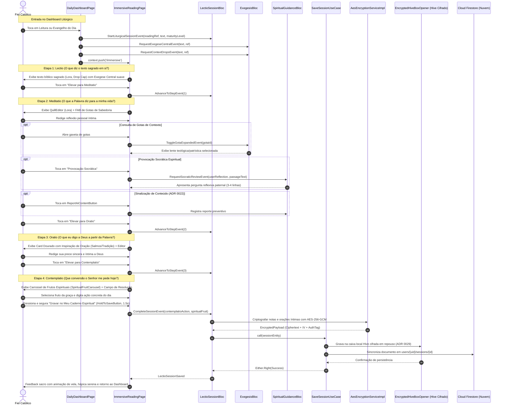

# Fluxo de Sessão — Lectio Divina (Experiência Imersiva Unificada)

Este diagrama de sequência detalha o ciclo de vida completo de uma prática de Lectio Divina na `ImmersiveReadingPage`, contemplando a resolução da Liturgia do Dia ou Passagem Livre, o editor de texto rico com Quill, a Provocação Socrática (*Magnifica Humanitas*), a denúncia de conteúdo de IA, o carrossel de frutos espirituais e a persistência criptografada em repouso (ADRs 0015, 0022, 0026, 0027 e 0029).

