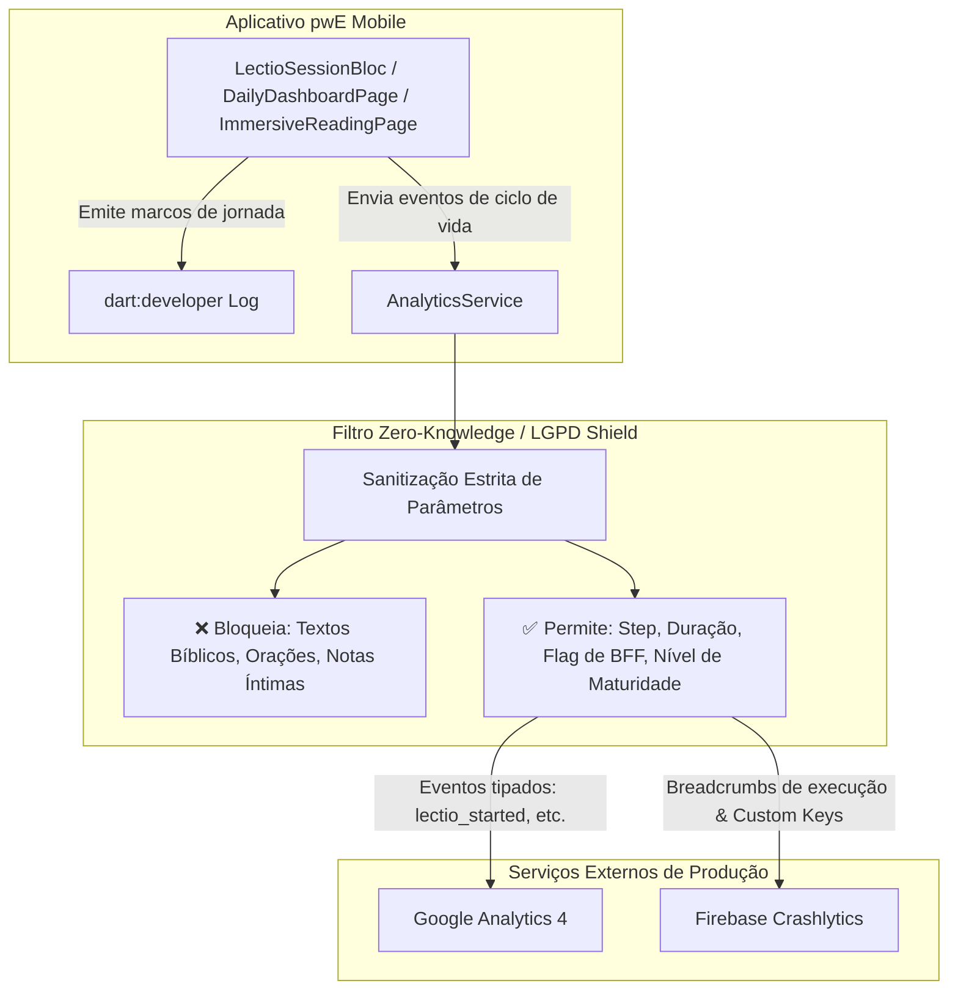

# Fluxo de Observabilidade & Princípio Zero-Knowledge

Este diagrama detalha a arquitetura de observabilidade em dupla camada adotada no pwE e demonstra como o filtro de privacidade **Zero-Knowledge** assegura que nenhum dado espiritual íntimo trafegue para servidores analíticos de terceiros.

---

## 1. Arquitetura de Observabilidade em Dupla Camada

---

## 2. Tabela de Mapeamento de Eventos e Parâmetros

| Evento | Camada de Console (`[LectioJourney]`) | Google Analytics 4 | Firebase Crashlytics |
| :--- | :--- | :--- | :--- |
| **Início da Leitura** | `✠ Iniciando Lectio: "{passage}"` | `lectio_started` (`reading_type`, `maturity_level`, `is_from_bff`) | Breadcrumb + Key `reading_type` |
| **Avanço de Etapa** | `📖 ➔ 🕊️ Transição para MEDITATIO` | `lectio_step_advanced` (`step_name`, `maturity_level`) | Breadcrumb de navegação |
| **Gotas de Contexto** | `💡 Abrindo gota de exegese` | `lectio_gota_opened` (`category`) | Breadcrumb |
| **Conclusão da Oração**| `💾 Persistindo sessão (Duração: {S}s)` | `lectio_completed` (`duration_seconds`, `has_notes`) | Key `duration_seconds` |
| **Erros e Falhas** | `❌ Falha na etapa {step}: {error}` | `error_occurred` (`error_type`) | `recordError(...)` com StackTrace |
