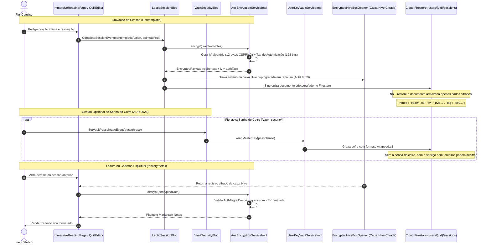

# Segurança & Criptografia Simétrica de Ponta a Ponta

Este documento descreve a estratégia de proteção e integridade de dados espirituais no aplicativo pwE, assegurando que as anotações do Caderno Espiritual e orações íntimas dos fiéis permaneçam absolutamente invioláveis tanto em trânsito quanto em repouso (ADRs 0010, 0026 e 0029).

---

## 1. Ciclo de Vida da Criptografia (AES-256-GCM, Cofre com Senha e Hive Cifrado)

---

## 2. Pilares de Segurança

1. **Algoritmo Padrão da Indústria**: Uso estrito do algoritmo **AES-256-GCM (Galois/Counter Mode)**, garantindo confidencialidade e autenticação de integridade contra adulterações.
2. **Vetores de Inicialização Únicos**: Cada operação gera um `IV` de 12 bytes aleatório via gerador criptográfico seguro (`Random.secure()`). É proibida a reutilização de IVs (`RN-SEC-090`).
3. **Cofre com Senha Opcional (`wrapped:v3` — ADR 0026)**:
   - *Com senha do cofre:* isolamento criptográfico integral. Nem administradores nem o provedor possuem acesso à chave.
   - *Sem senha do cofre:* a segurança é garantida pelo Keystore do Android / Keychain do iOS e controles de infraestrutura.
4. **Cifra em Repouso no Hive (ADR 0029)**: A caixa física de sessões locais no disco do aparelho é aberta via `EncryptedHiveBoxOpener`, impedindo inspeções forenses de arquivos locais.
5. **Proteção Visual contra Capturas (`RN-SEC-092`)**: Ativação nativa de `FLAG_SECURE` no Android e proteção de prévia no iOS contra prints e gravações acidentais da intimidade orante.
