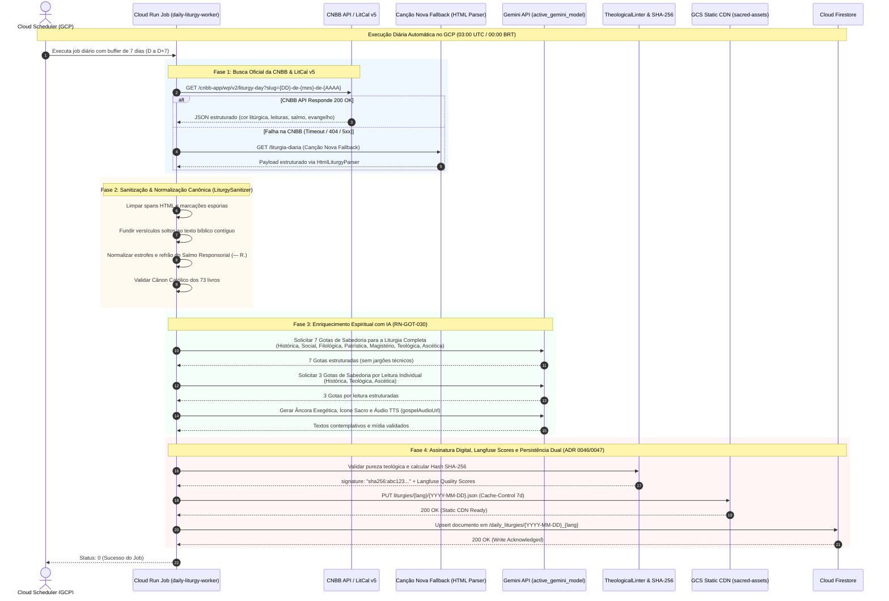
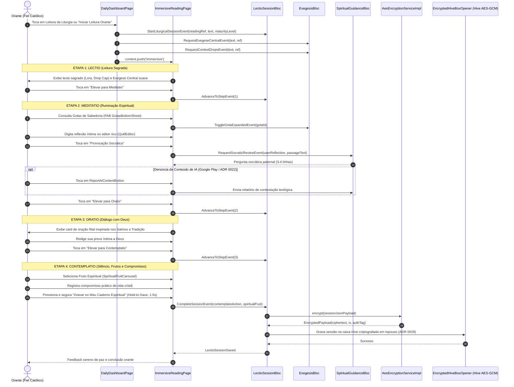
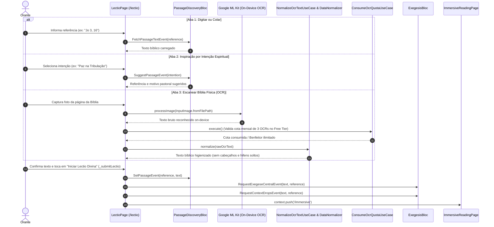
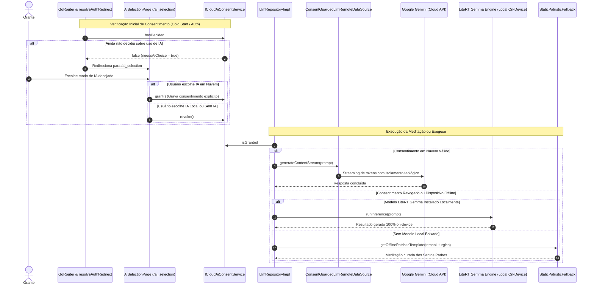
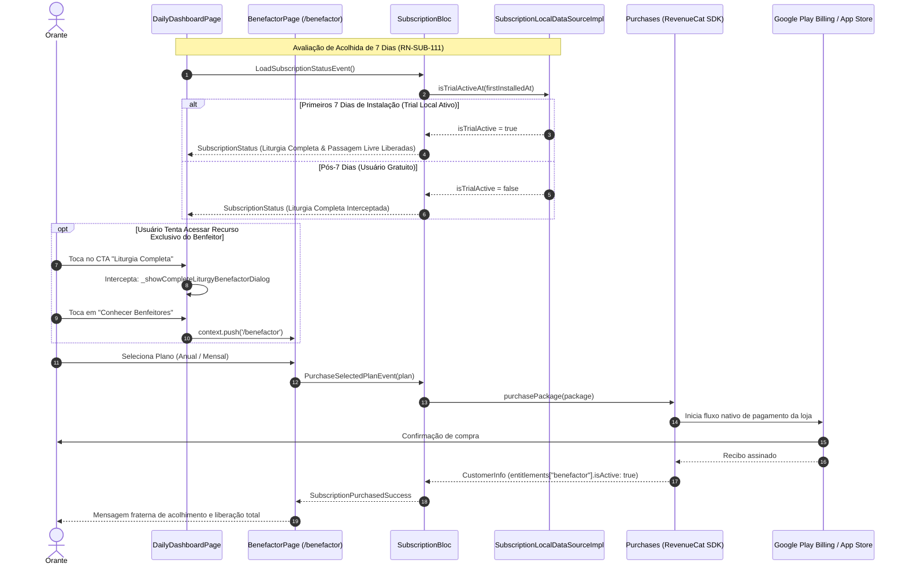

# Diagramas de Sequência do Sistema — pwE (Pray With Me)

Este documento reúne os diagramas de sequência dos 5 fluxos operacionais mais críticos da arquitetura do aplicativo pwE, modelados em **Mermaid** e estritamente aderentes à base de código atual (`v0.9.113+141` / ADRs 0001–0050).

---

## 1. Ingestão e Pré-processamento Noturno da Liturgia Diária

Este fluxo ilustra o pipeline automatizado em nuvem que executa diariamente via **Cloud Scheduler e Cloud Run Job no Google Cloud Platform (GCP)** às 03:00 UTC (00:00 BRT) para popular a Liturgia no **GCS Static CDN** e no **Cloud Firestore** com antecedência para os fiéis.

---

## 2. Jornada Imersiva da Lectio Divina (4 Degraus Desacoplados)

Demonstra o ciclo imersivo do orante no app pwE através dos Sub-BLoCs especializados da feature `lectio_divina` (ADR 0015 e ADR 0027), transitando pelas etapas da *Lectio*, *Meditatio*, *Oratio* e *Contemplatio*.

---

## 3. Passagem Livre e OCR Bíblico via Google ML Kit

Fluxo do usuário que acessa a rota `/lectio` (`LectioPage`) para rezar com sua Bíblia física ou qualquer trecho livre do Cânon Católico dos 73 livros.

---

## 4. Orquestração Híbrida de IA: Consentimento em Nuvem vs On-Device (LiteRT)

Demonstra o controle ético de privacidade estabelecido pela **ADR 0025** (Consentimento Explícito para IA em Nuvem) e os mecanismos de execução entre a nuvem (Gemini) e a borda local (LiteRT Gemma 4 E2B).

---

## 5. Ciclo de Monetização, Acolhida e Benefactor via RevenueCat

Ilustra o ciclo de vida de acesso governado pelo `SubscriptionBloc` e pelo RevenueCat SDK, garantindo transparência fraterna e gratuidade perpétua da Liturgia Diária.

