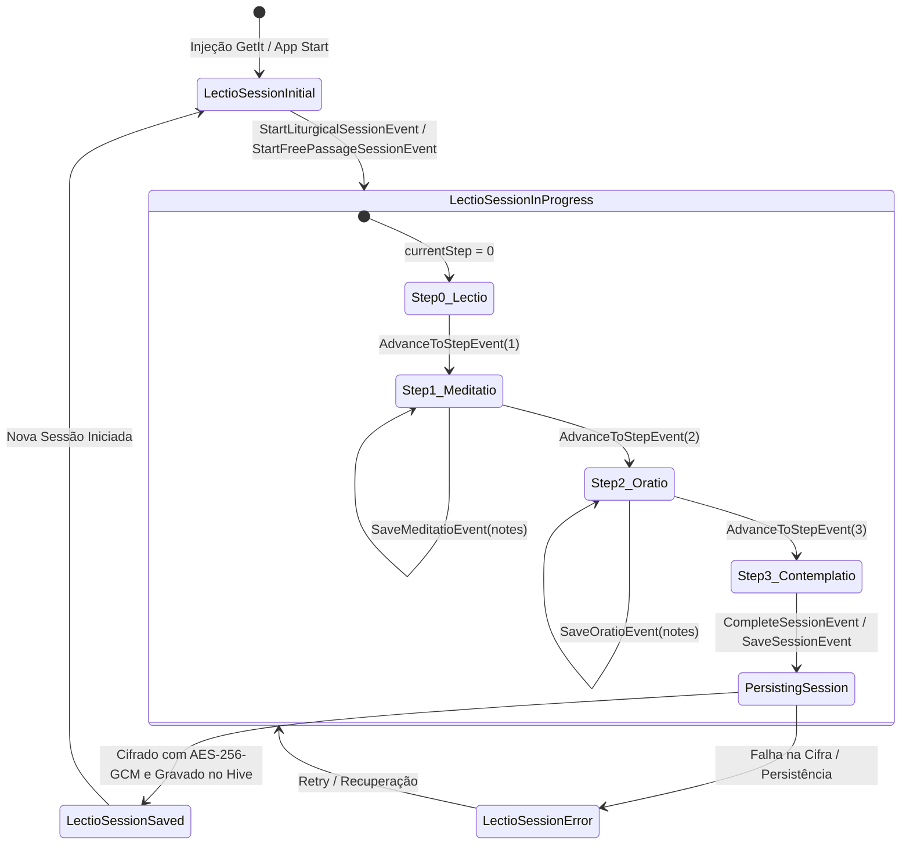
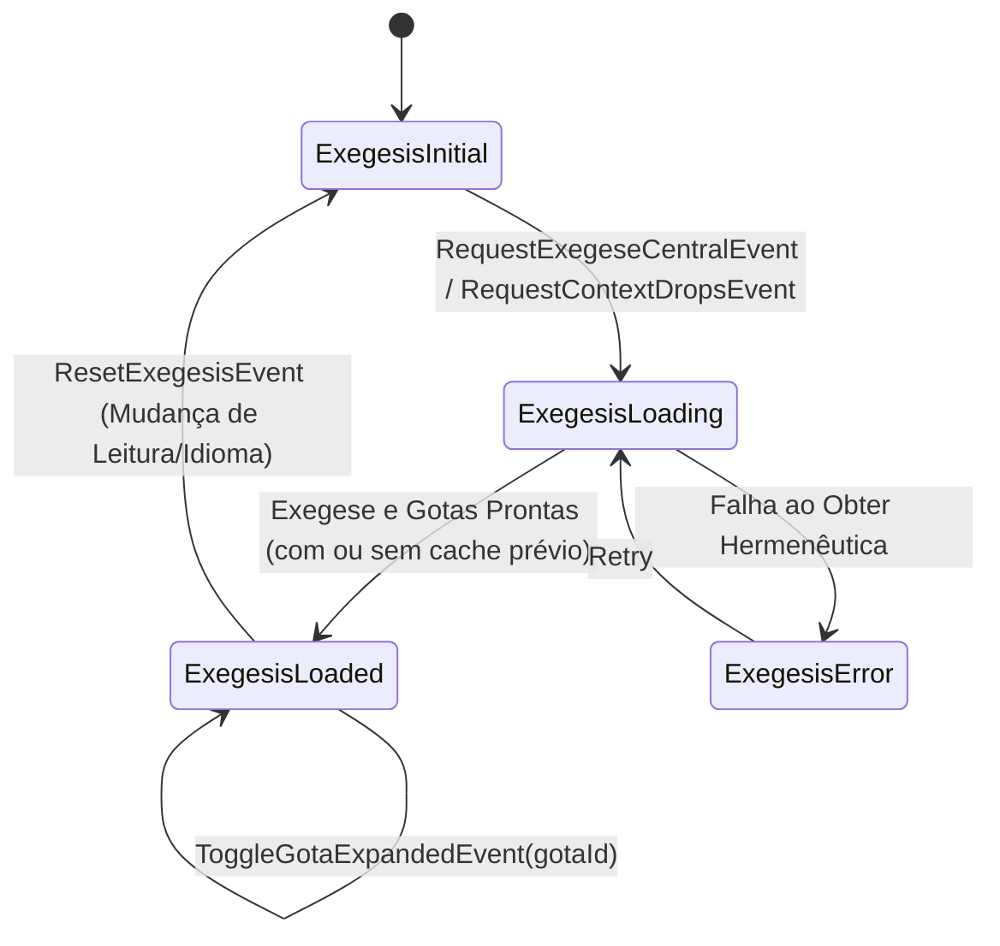
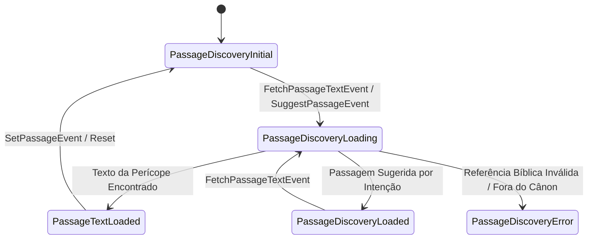
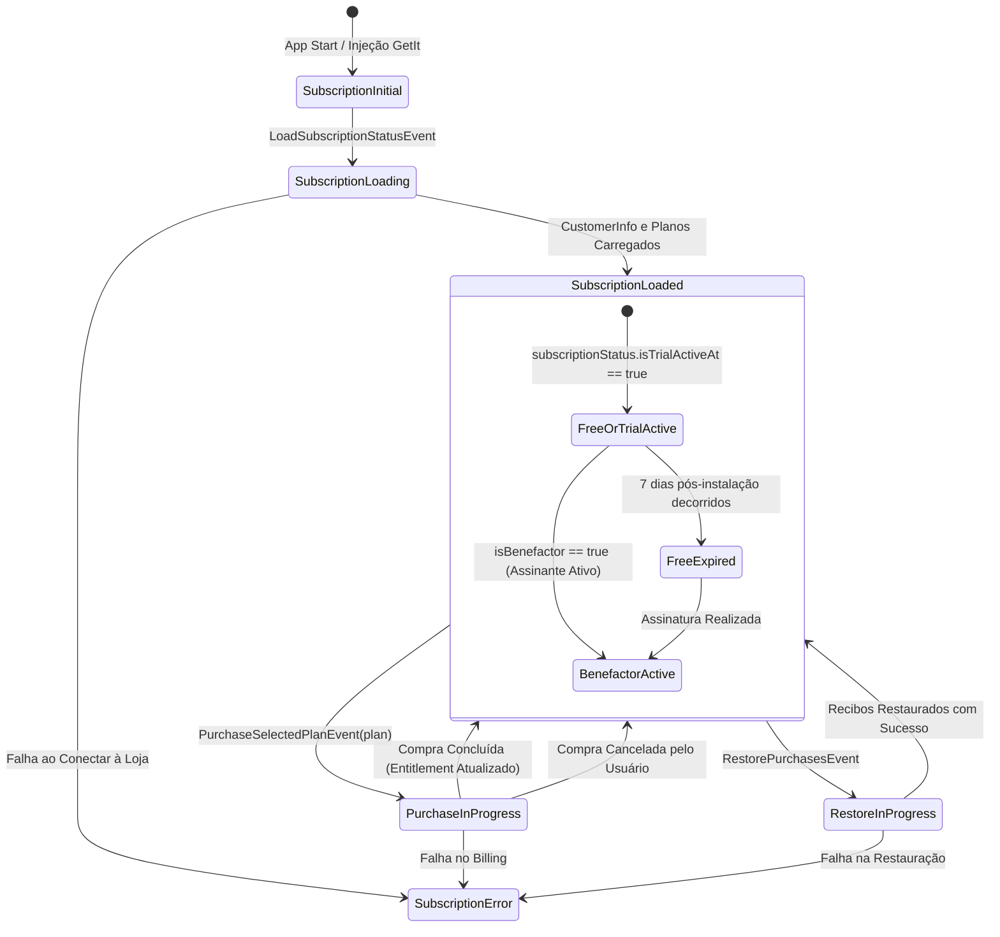
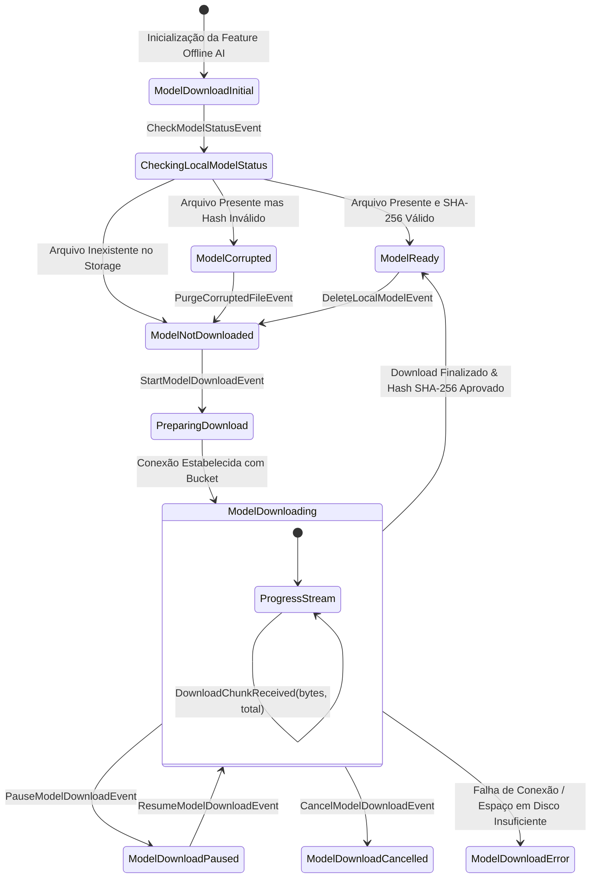
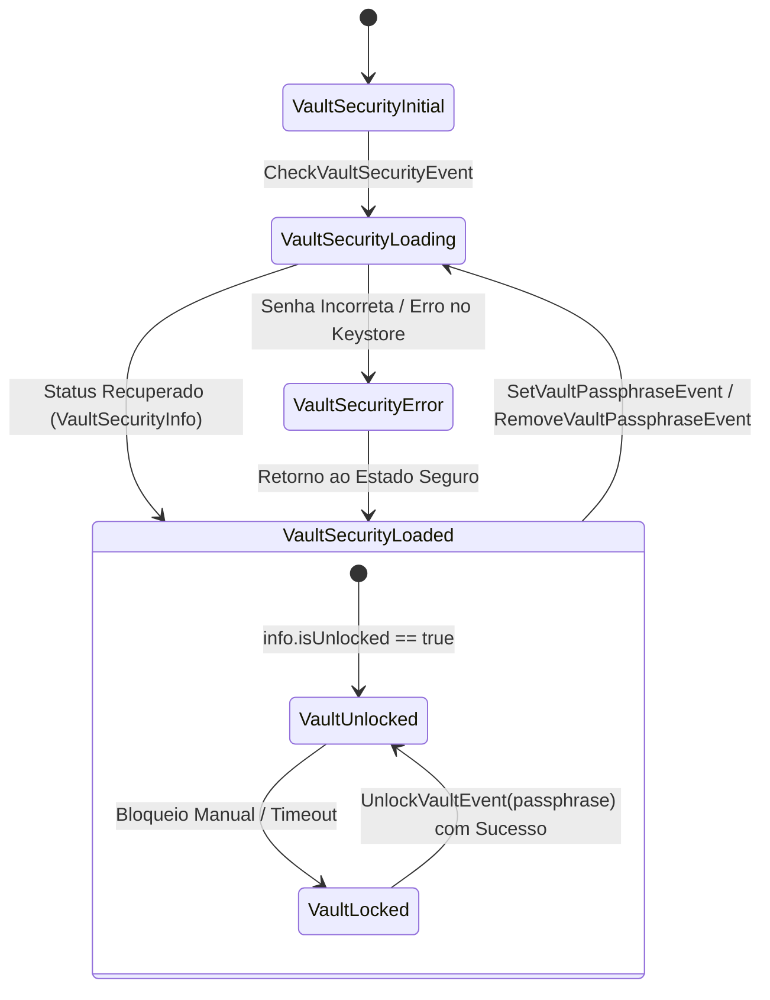

# Máquinas de Estados do Sistema — pwE (Pray With Me)

Este documento mapeia visualmente e detalha as principais **Máquinas de Estados** do aplicativo pwE, implementadas com `flutter_bloc` e orquestradas por eventos reativos, rigorosamente alinhadas à base de código atual (`v0.9.113+141` / ADRs 0001–0050).

---

## 1. Máquinas de Estados do Domínio Lectio Divina (Sub-BLoCs Desacoplados)

Com a arquitetura desacoplada de Sub-BLoCs (ADR 0015 e ADR 0027), o ciclo orante é governado por máquinas de estados especializadas:

### 1.1 `LectioSessionBloc`: Ciclo de Vida da Sessão e Degraus Orantes

### 1.2 `ExegesisBloc`: Exegese Central e Gotas de Sabedoria

### 1.3 `PassageDiscoveryBloc`: Busca de Passagem e Inspiração

---

## 2. Máquina de Estados: `SubscriptionBloc`

Gerencia o ciclo de monetização sustentável e transparente do pwE via RevenueCat SDK, calculando a acolhida de 7 dias e governando o acesso aos recursos de Benfeitor.

---

## 3. Máquina de Estados: `ModelDownloadBloc` (LiteRT Gemma On-Device)

Gerencia a verificação, download em segundo plano e validação de integridade por hash do modelo de Inteligência Artificial local compacto (LiteRT Gemma 4 E2B, arquivo `gemma_4_e2b.litertlm`).

---

## 4. Máquina de Estados: `VaultSecurityBloc` (Cofre com Senha Opcional — ADR 0026)

Governa o estado de segurança e derivação de chave mestra para o Caderno Espiritual na rota `/vault_security`.

